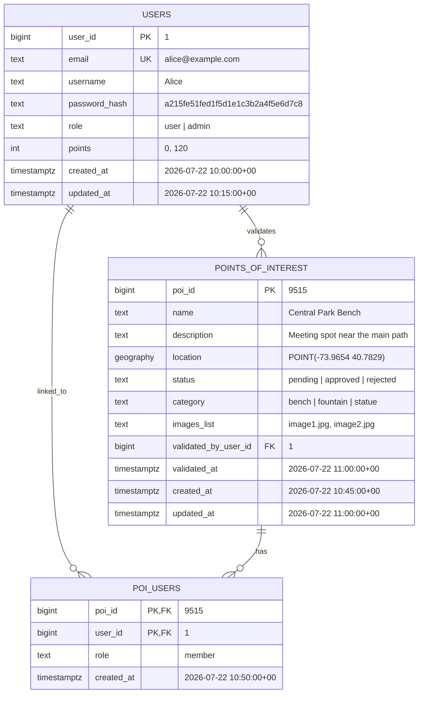

# Database

## Visual schema

## Rules

- `email` must be unique and not null.
- `password_hash` stores the hashed password, never the raw password.
- `role` can be something like `user` or `admin`.
- `points` should default to `0`.
- `status` lets a POI stay `pending` until an admin approves it.
- `validated_by_user_id` stores which admin approved the POI.
- `poi_users` is the join table that lets one point of interest list several users.
- `location` can be a PostGIS geography point if you want map queries later.