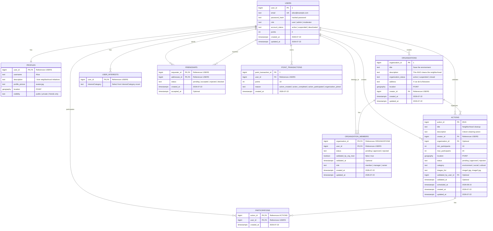

# Database

## Visual schema

## Rules

- `email` must be unique and not null.
- `password_hash` stores the hashed password, never the raw password.
- `role` can be something like `user` or `admin`.
- `points` should default to `0`.
- `status` lets an action stays `pending` until an admin approves it.
- `validated_by_user_id` stores which admin approved the action.
- `participations` is the join table that lets one action list several users.
- `location` can be a PostGIS geography point if you want map queries later.
- A `user` has one `profile`.
- A `user` can participate in several `actions`.
- A `user` can belong to several `organizations`.
- An `organization` can have several `members`.
- A `user` can select several `interests`.
- `USER_INTERESTS` is the join table between `users` and `interests`.
- A `friendship` links two users and has a status such as `pending`, `accepted`, `rejected`, or `blocked`.
- User account status is separate from the user role.
- Organization status is separate from membership status.
- `POINT_TRANSACTIONS` stores the history of points earned by users.
- `USERS.points` stores the current total for quick access.
- The user status level is derived from the points total:
  - `< 70`: Petit PiouPiou
  - `70-209`: Grand PiouPiou
  - `>= 210`: PiouPiou d'Or