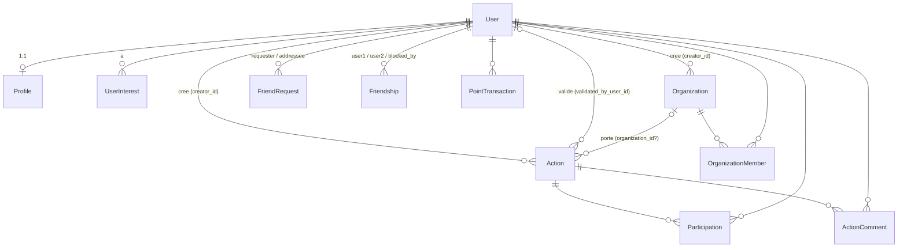

# Plan des données — côté frontend (Pioupiounades)

État au 2026-09-24, branche `feature/map-create-action` (= `main` + `fix/main-build` + `feature/50-auth-ui` + Epic 7).
Sources de vérité, dans l'ordre : `backend/prisma/schema.prisma` (la base) → `docs/api_contract.md` (ce que l'API
fait réellement, régénéré et vérifié par sondes le 24/09, resondé le 01/10) → `features/<x>/types.ts` (ce que le front en voit).
Ce document ne duplique pas le contrat : il dit **où vit chaque donnée côté front, par quel module deep elle passe,
et ce qu'un appelant doit savoir**. Les termes Module / Interface / Deep / Seam sont ceux de `CLAUDE.md`.

Légende des états : ✅ fait et branché sur l'API · 🟡 fait en mock ou partiel · 🔜 en PR / en branche non mergée · ❌ absent.

---

## 1. Vue d'ensemble : le chemin d'une donnée

```
 PostgreSQL 17 ──Prisma 7──► NestJS 11 (70 routes, JWT 15 min + refresh 7 j, pas de CORS)
                                   │  JSON, ids BigInt → string, location [lat, lng], dates ISO
                                   ▼
                     Vite dev proxy  /api/*  →  http://backend:3000/*      (prod : Nginx, pas branché)
                                   │
                                   ▼
   shared/api  ──────────  http.get/post/patch/delete/list  +  session (tokens)  +  ApiError
        ▲                 (seul module qui connaît fetch, la base URL, le Bearer, le refresh)
        │  appelé UNIQUEMENT par features/<x>/api/*
        │
   features/auth ───── AuthProvider · useAuth · RequireAuth · LoginPage · RegisterPage
   features/actions ── MapPage · NeighborhoodMap · ActionForm · useActions · useCreateAction · (détail : mock)
   features/profile ── ProfilePage (mock, à brancher sur /profiles)
        ▲
        │  composition : routes, layout, libellés de la coquille
   app/ ─────────────── router.tsx · routes.ts · layout/* · pages/*      +  shared/ui · shared/hooks · shared/lib
```

Sens unique des dépendances : `app → features → shared` (ESLint `no-restricted-imports` : pas de chemin interne
`features/x/…`, pas d'`app/` depuis `features`/`shared`, pas de `features/` depuis `shared`).
Aucun état serveur global côté front : chaque hook `useX` porte ses données ; TanStack Query (prévu) se branchera
dans `features/<x>/api/*` sans toucher aux composants.

---

## 2. Le modèle de données : base → API → front

### 2.1 Entités

| Entité Prisma | Clé, champs qui comptent | Exposée par | Feature front propriétaire → type | État front |
|---|---|---|---|---|
| **User** | `user_id`, `email` (unique), `role` RoleApp, `account_status`, `points`, dates. `password_hash` et `refresh_token` jamais renvoyés | `/auth/*` (5), `/users/*` (9) | `features/auth` → `AuthUser` (= `User` du contrat) | ✅ session, login, register, `/auth/me` |
| **Profile** | `user_id` (PK = FK User, 1:1), `username` (unique), `description?`, `profile_picture?` (URL), `location` (seulement sur `GET /profiles/me`), `commune?` (déduite de `location`, 01/10), `visibility` | `/profiles/*` (7, dont l'avatar) | `features/profile` → `UserProfile` **(mock, forme ≠ contrat)** | 🟡 page mock, aucun appel API |
| **UserInterest** | (`user_id`, `interest` InterestCategory), 9 valeurs | `/interests/*` (3) | `features/profile` (prévu) | ❌ |
| **Action** | `action_id`, `title`, `description`, `creator_id`, `organization_id?`, `min_participants` (défaut 3), `max_participants?`, `location`, `status`, `category`, `images_before`, `images_after` (ex-`imagesList`, 01/10), `validated_by_user_id?`, `validated_at?`, `scheduled_at`. **L'API ajoute `participant_count` et `remaining_seats`** (liste et détail, depuis #45) | `/actions/*` (7 + 2 commentaires) | `features/actions` → `Action` (§4.7) | ✅ liste, carte, création (`Action` enrichie, `ActionRecord` pour les mutations) · 🟡 détail (mock `ActionDetailData`) |
| **ActionComment** | `comment_id`, `content` (≤ 1024), `user_id`, `action_id`, dates ; renvoyé avec `user: { user_id, profile: { username, profile_picture } \| null }` | `POST/GET /actions/:id/comments` | `features/actions` → `ActionComment` | ✅ lecture + envoi sur la page d'action (#70, id numérique seulement tant que la fiche est un mock) |
| **Participation** | (`action_id`, `user_id`), `created_at` | `/participations/*` (4) | `features/participations` (prévu) | ❌ |
| **Organization** | `organization_id`, `title`, `description`, `organization_status`, `address`, `location`, `creator_id` | `/organizations/*` (8) | `features/organizations` → `Organization` | 🟡 liste + recherche + fiche publique (#61) ; création/édition ❌ |
| **OrganizationMember** | (`organization_id`, `user_id`), `status` MemberStatus, `role` RoleOrg, `validated_by_org_man`, `validated_at?` | `/organization-members/*` (14) | `features/organizations` → `OrganizationMember` | 🟡 membres actifs affichés sur la fiche (#61) ; adhésion/gestion ❌ |
| **OrganizationComment** | `comment_id`, `content` (≤ 1024), `user_id`, `organization_id`, dates ; renvoyé avec `user: { user_id, profile \| null }` | `POST/GET /organizations/:id/comments`, `DELETE /organizations/comments/:commentId` | `features/organizations` → `OrganizationComment` | ✅ lecture, envoi, suppression (auteur ou créateur de l'organisation) sur la fiche (#71) |
| **FriendRequest** | `friend_request_id`, `requester_id`, `addressee_id`, `status`, `responded_at?` | `/friend-requests/*` (5) | `features/friends` (prévu) | ❌ (`/friends` = placeholder) |
| **Friendship** | (`user1_id`, `user2_id`), `status` ACTIVE/BLOCKED, `blocked_by_user_id?` | `/friendships/*` (5) | `features/friends` (prévu) | ❌ |
| **PointTransaction** | `point_transaction_id`, `user_id`, `points`, `reason`, `event_key` (unique, idempotence) | 1 route admin, **aucune lecture** : le solde est `User.points` | `features/auth` (`user.points`) | 🟡 solde disponible, jamais affiché |

`PiouPiouStatus` est déclaré dans le schéma mais utilisé par aucun modèle. Aucun modèle « Suggestion » : une
suggestion est une `Action` `PENDING` (c'est le choix fait pour l'Epic 7, voir §6).

### 2.2 Relations



En clair : tout tourne autour de `User`. `Action` est le pivot fonctionnel (créateur, organisation optionnelle,
participants, commentaires, validateur). `Organization` n'existe pour un utilisateur qu'à travers `OrganizationMember`.
Les amitiés sont en deux temps : `FriendRequest` (demande) puis `Friendship` (lien, blocable).

### 2.3 Enums et leurs libellés UI

Règle : un enum est possédé par une feature, traduit dans son `labels.ts`, jamais en dur dans le JSX (UI en anglais).

| Enum | Valeurs | Owner front | Libellés |
|---|---|---|---|
| `Category` | `ENVIRONMENT`, `SOCIAL`, `CULTURAL` | `features/actions` (`CATEGORY`) | Environment · Mutual aid · Culture & sharing ; icônes leaf · heart · sun ; pins forêt · terracotta · ocre |
| `ActionStatus` | `PENDING`, `APPROVED`, `REJECTED`, `CANCELLED`, `COMPLETED` | `features/actions` (`ACTION_STATUS`, `OPEN_STATUSES` = PENDING + APPROVED) | Upcoming · Confirmed · Rejected · Cancelled · Completed |
| `RoleApp` | `USER`, `ADMIN`, `MODERATOR` | `features/auth` (`ROLE_APP`) | User · Admin · Moderator (`features/admin/labels.ts`, espace admin seulement) |
| `AccountStatus` | `ACTIVE`, `SUSPENDED`, `DEACTIVATED` | `features/auth` (`ACCOUNT_STATUS`) | Active · Blocked · Deactivated (`features/admin/labels.ts`) ; icônes check · lock · close |
| `ProfileVisibility` | `PUBLIC`, `PRIVATE`, `FRIENDS_ONLY` | `features/profile` (type union seulement) | select du mock : à revoir avec le contrat (`FRIENDS_ONLY` traité comme privé par l'API) |
| `InterestCategory` | 9 valeurs `ENV_*`, `SOCIAL_*`, `CULTURAL_*` | à créer dans `features/profile` | ❌ |
| `OrganizationStatus`, `MemberStatus`, `RoleOrg` | voir contrat §2 | `features/organizations/types.ts` (#61) | ✅ |
| `FriendRequestStatus`, `FriendshipStatus` | voir contrat §2 | à créer dans `features/friends` | ❌ |
| `PointReason` | 10 valeurs | jamais reçu par le front (pas de route de lecture) | — |

### 2.4 Cycles de vie qui structurent l'UI

- **Action** : `PENDING` (création, inscriptions ouvertes) → `APPROVED` (`approve` : ADMIN, **le créateur lui-même**,
  MANAGER/OWNER de l'orga, **et au moins 3 participants hors créateur**) → `COMPLETED` (`complete`, même règle, distribue les
  points) ; `PENDING`/`APPROVED` → `CANCELLED` (`cancel`). `REJECTED` est **inatteignable** (pas de route). Pas de suppression.
  Une action ne se modifie plus une fois `CANCELLED`/`COMPLETED`/`REJECTED`. `PATCH /actions/:id` ne renvoie plus 500 (corrigé,
  vérifié le 01/10) mais **remet `images_before` / `images_after` à `[]`** quand le body ne les contient pas.
- **Participation** : possible **uniquement sur `PENDING`** (join et leave), plafond `max_participants`, le créateur ne
  peut pas s'inscrire. Cohérent avec `approve` (≥ 3 participants) : `PENDING` = ouverte, `APPROVED` = confirmée et close.
  La contradiction est avec `Docs/user_stories.md` (modération avant publication) : à trancher en équipe.
- **Compte** : `ACTIVE` → `DEACTIVATED` (par soi, irréversible via l'API) ; `ACTIVE` ↔ `SUSPENDED` (ADMIN, −50 points).
  Presque toute écriture exige `ACTIVE` (sinon 400, parfois 403).
- **Membre d'organisation** : `join` → `PENDING` → `approve`/`deny` → `ACTIVE`/`REJECTED` (définitif) ; `ban` → `BANNED` ;
  rôles `MEMBER` → `MANAGER` → `OWNER` (un seul propriétaire, transfert obligatoire avant de partir).
  **Bug backend** : `POST /organizations` ne crée pas le membre `OWNER`, donc `leave`/`add`/`approve` échouent (404 « Organization owner not found »).
- **Amitié** : `send` (`PENDING`) → `accept` (crée `Friendship ACTIVE`) / `reject` ; `block`/`unblock` seulement entre amis ; `DELETE` seulement si `ACTIVE`.

---

## 3. Le contrat back ↔ front (les règles que tous les modules front respectent)

- **Identité** : elle vient du JWT (`req.user.id`). Jamais d'id utilisateur dans une query ou un body pour dire « qui je suis » ;
  `creator_id` dans un body → 400 (`forbidNonWhitelisted`).
- **Ids** : `string` en réponse (`"12"`), **entier** dans un body (`organization_id: 12`), string dans l'URL. Un id non
  numérique dans l'URL → 500 (sauf `/organization-members` et les commentaires : 400).
- **Localisation** : `location = [latitude, longitude]` (type front `LatLng`), l'ordre de Leaflet. Pas de PostGIS ;
  le rayon (`GET /organizations?lat&lng&radius`) est calculé en mémoire. **Aucune recherche d'actions par rayon exposée**.
- **Dates** : ISO 8601 en string ; `scheduled_at` envoyé par le front en `new Date(local).toISOString()`.
- **Listes vides** : un `GET` filtré sans résultat renvoie **404** ; `http.list` le traduit en `[]`. `GET /actions` n'applique
  **qu'un seul filtre** (priorité `organization_id` > `category` > `creator_id` > `status`) : le filtrage combiné est fait côté front.
- **Erreurs** : `{ statusCode, message, error }`, `message` parfois tableau → `ApiError { status, messages, isNetwork }`.
  Codes : 400 (règle métier ou DTO), 401 (token), 403 (rôle), 404, 409 (membres, points), 500 (Prisma non intercepté).
  Chaque feature traduit les messages qu'elle connaît dans son `errors.ts` ; le reste → message générique.
- **Session** : access token 15 min en mémoire, refresh 7 j persisté (`localStorage`, clé `pioupiounades.session`, rotation à
  chaque refresh : un token utilisé deux fois → 401 « Access Denied » → déconnexion).
- **Points** (contrat §14) : automatiques, jamais saisis par le front. `complete` : +20 créateur, +10 par participant,
  +5 au créateur par participant ; membres d'orga ±5 à l'`OWNER` ; ban −15 ; suspension −50. Un bénéficiaire non `ACTIVE`
  fait **échouer la route appelante** (à afficher explicitement sur `complete`).
- **Non couvert par l'API aujourd'hui** (ne pas contourner, ticket backend) : édition d'action fiable (bug `PATCH`), rejet d'action, suppression d'action ou de compte,
  service des fichiers uploadés (les routes d'upload existent depuis le 01/10, mais `/static/...` n'est servi par rien), notifications,
  messagerie, lecture des points, annulation d'une demande d'amitié ou d'adhésion, recherche par texte/date/rayon d'actions.

---

## 4. Modules deep côté frontend et leurs interfaces

Format : **Interface** = ce qu'un appelant doit savoir (et rien de plus) · **Caché** = ce qu'il n'a pas à savoir ·
**Seam** = où l'on peut substituer une implémentation.

### 4.1 `shared/api` — le client HTTP (référence de module deep)

```ts
import { http, session, ApiError, isApiError, type RequestOptions, type SessionTokens } from '@/shared/api';

http.get<T>(path, { query?, signal? })            // → Promise<T>
http.post<T>(path, body?, options?)              // 201/200 → T
http.patch<T>(path, body?, options?)
http.delete<T>(path, options?)
http.list<T>(path, options?)                     // → Promise<T[]> ; 404 « rien trouvé » → []

class ApiError { status: number; messages: readonly string[]; isNetwork: boolean }   // status 0 = réseau
isApiError(e): e is ApiError

session.set(tokens, userId?)  // après login/register (userId requis), après refresh (conservé)
session.clear()               // logout local
session.onExpire(listener)    // refresh impossible → l'appelant repasse en anonyme ; renvoie la désinscription
session.userId / accessToken / refreshToken / exists
```

Caché : base URL (`env.apiUrl`, `/api` en dev), header `Authorization: Bearer`, JSON in/out, 204 et corps vides,
`message` tableau normalisé, 401 → `POST /auth/refresh` **dédupliqué** → rejeu ; si l'access token est absent
(rechargement) le refresh est fait **avant** le premier appel ; `/auth/login|register|refresh` ne déclenchent jamais de
refresh ; stockage des tokens. Seam : `fetch` (doubles réseau en test). Appelants autorisés : `features/*/api/*` seulement.

### 4.2 `shared/config/env`

`env.apiUrl` (string, sans slash final). Caché : lecture de `import.meta.env.VITE_API_URL`, validation au démarrage
(erreur explicite si `.env` manque). `VITE_DEV_PROXY_TARGET` n'est lu que par `vite.config.ts`.

### 4.3 `shared/hooks/useForm` — état d'un formulaire contrôlé

```ts
const form = useForm(initialValues, validators, submit, toErrorMessage);
// initialValues : Record<string, string | boolean> ; validators : { [champ]?: (value, values) => string | null }
// submit(values) : Promise<void> (une exception devient form.serverError via toErrorMessage)
form.values · form.setValue(name, value) · form.touch(name) · form.errorOf(name)   // erreur visible après blur ou soumission
form.serverError · form.submitting · form.handleSubmit   // onSubmit du <form noValidate>
```

Caché : quand une erreur s'affiche, focus du premier champ invalide (`id` du champ = son nom), cycle d'envoi.
Aucune connaissance métier : chaque feature fournit ses validateurs (`validation.ts`) et son mapper d'erreurs (`errors.ts`).
Appelants : `LoginPage`, `RegisterPage`, `ActionForm`.

### 4.4 `shared/ui` — le kit (DESIGN.md §9), zéro type métier

| Composant | Interface (props utiles) |
|---|---|
| `Button` | `variant` primary/secondary/text · `size` md/lg · `block` · `loading` + `loadingLabel` · props `<button>` (`type` = button par défaut) |
| `ButtonLink` | mêmes props de style + props de `Link` (react-router) |
| `FloatingField` | `id`, `label`, `error?`, `help?`, `type` text/email/password/number/datetime-local, `revealLabels?` (mot de passe), props `<input>` ; erreur reliée par `aria-describedby` |
| `FloatingTextarea` | `id`, `label`, `error?`, `help?`, `rows?`, props `<textarea>` |
| `Checkbox` | `id`, `error?`, `children` (libellé riche) |
| `Chip` | `pressed` (→ `aria-pressed`), `icon?`, `children` : bouton à bascule, jamais un lien |
| `Dialog` | `open`, `onClose` (croix, Échap, fond), `title`, `closeLabel`, `children` montés seulement si ouvert ; `<dialog>` natif |
| `Avatar` | `name`, `src?`, `size?` (initiales si pas d'image) |
| `Icon` / `iconMarkup` | `name: IconName` (15 icônes trait 24×24), `size?`, `title?` (sinon décorative) ; `iconMarkup(name, size)` = même SVG en string pour Leaflet |

Caché : CSS Modules sur les tokens de `styles/tokens.css`, états focus/disabled, `FieldShell` + `fieldA11y` (privés).

### 4.5 `shared/lib` — fonctions pures, import direct (pas de barrel)

`pageTitle(title)` → « Title · pioupiounades » (+ `BRAND_NAME`) · `formatDateTime(iso)` → « Sat 12 Sept · 10:30 » (vide si invalide) ·
`prefersReducedMotion()` (lu à chaque appel).

### 4.6 `features/auth` — session et écrans de connexion

```ts
import { AuthProvider, useAuth, RequireAuth, LoginPage, RegisterPage, AUTH_ROUTES,
         ROLE_APP, ACCOUNT_STATUS, type AuthUser, type AuthStatus } from '@/features/auth';

useAuth() → { status: 'loading' | 'anonymous' | 'authenticated', user: AuthUser | null,
              signIn({ email, password }), signUp({ email, password }), signOut() }   // signIn/signUp rejettent l'ApiError
<RequireAuth />            // route parente sans path : loading → message, anonyme → /login avec state.from, sinon <Outlet/>
<RequireRole role denied /> // sous RequireAuth : rôle exact → <Outlet/>, sinon `denied` (la page 404) ; confort d'UI, le backend revérifie
AUTH_ROUTES                // { login: '/login', register: '/register' } : app/routes.ts les compose
<RegisterPage termsPath privacyPath />   // une feature n'importe pas app/ : les chemins légaux arrivent en props
type AuthUser = { user_id, email, role, account_status, points, created_at, updated_at }   // = User du contrat
```

Caché : `api/authApi` (`login`, `register`, `getMe`, `logout`), démarrage (`session.exists` → `GET /auth/me`, sinon anonyme,
sans flash de redirection), abonnement `session.onExpire`, `validation.ts` (e-mail, mot de passe ≥ 8 = DTO, consentement),
`errors.ts` (401 → identifiants, 400 « Email is already used » → compte existant), `useReturnPath` (retour vers `state.from`),
`AuthLayout` / `AuthHero` / `AuthBackdrop`, `labels.ts`. Ne connaît **pas** les tokens : `session.set(tokens, user_id)` et c'est tout.

### 4.7 `features/actions` — actions, carte, création

Interface publique (`index.ts`) :

```ts
import { MapPage, ActionDetailPage, ActionDetailsView,
         CATEGORY, ACTION_STATUS, OPEN_STATUSES, CATEGORY_LABELS, ACTION_STATUS_LABELS, CATEGORY_ICONS,
         type Action, type ActionStatus, type Category, type LatLng } from '@/features/actions';

type LatLng = [latitude: number, longitude: number];
type Action = { action_id, title, description, creator_id, organization_id: string | null,
                min_participants: number | null, max_participants: number | null, location: LatLng,
                status: ActionStatus, category: Category, images_before: string[], images_after: string[],
                validated_by_user_id: string | null, validated_at: string | null,
                scheduled_at, created_at, updated_at,
                participant_count: number, remaining_seats: number | null }   // calculés par GET /actions(/:id)
type ActionRecord = Omit<Action, 'participant_count' | 'remaining_seats'>   // réponse des mutations (POST, PATCH, approve…)
```

Modules internes et leurs interfaces (un appelant lit ceci, pas l'implémentation) :

| Module | Interface | Caché |
|---|---|---|
| `api/actionsApi` | `fetchActions(signal?) → Promise<Action[]>` · `createAction(input: CreateActionInput) → Promise<ActionRecord>` · `CreateActionInput = { title, description, category, location, scheduled_at, max_participants?, organization_id? }` | chemins `/actions`, `http` |
| `api/useActions` | `useActions() → { actions, loading, error: ApiError \| null, reload() }` | AbortController, `loading` dérivé du n° de tentative, 404 → `[]` |
| `api/useCreateAction` | `useCreateAction() → (input) => Promise<Action>` | seam TanStack `useMutation` |
| `api/useActionComments` (#70) | `useActionComments(actionId) → { comments, loading, notFound, error, reload, prepend }` | `GET /actions/:id/comments` via useResource, plus récent en premier ; `prepend` insère en tête ce qui vient d'être posté sans recharger |
| `api/usePostComment` (#70) | `usePostComment() → (actionId, content) => Promise<ActionComment>` | seam TanStack `useMutation` |
| `components/ActionComments` (#70) | `{ actionId }` | discussion publique sous la fiche : composer si connecté (CommentComposer, règle `validateComment` ≤ 1024), lien `/login` sinon, états chargement / vide / 404 / erreur, « You » sur mes commentaires ; monté par ActionDetailPage pour un id numérique seulement (#60 lèvera la garde) |
| `api/actionDetailMock` **(mock #46)** | `useActionDetail(id) → { action: ActionDetailData \| null, isLoading, error }` | données fictives ; à remplacer par `GET /actions/:id` + participants + commentaires |
| `pages/MapPage` | route `/map` ; lit/écrit `?at=lat,lng` (brouillon) | filtre `OPEN_STATUSES` + catégorie, sélection pin ↔ carte, popup brouillon (bouton si connecté, lien `/login` sinon), dialog de création, `reload()` + sélection + message après création |
| `components/NeighborhoodMap` | `{ actions (mémoïsées), selectedId, onSelect(id \| null), draft?: LatLng \| null, onDraftChange?(LatLng), draftContent?: ReactNode }` | Leaflet/OSM, pins `divIcon` CSS par catégorie, cache d'icônes, fitBounds / centre par défaut Saint-Cyprien, géoloc à la demande, clic fond → brouillon (un clic qui ferme un popup ne place rien), pin brouillon déplaçable + popup auto |
| `components/ActionCard` | `{ action, selected, onSelect(id) }` (bouton à bascule, miroir du pin) | libellés, format de date |
| `components/CategoryFilter` | `{ value: Category \| null, onChange }` | `Chip` |
| `components/ActionForm` | `{ location: LatLng, onCreated(action: ActionRecord), onCancel() }` | `useForm` + `validation.ts` (titre ≤ 80, description ≤ 600, catégorie, date future, `max_participants` vide ou ≥ 3), envoi, `errors.ts`, focus ; **réutilisable par le futur écran créer/modifier** |
| `components/CreateActionDialog` | `{ location: LatLng \| null (null = fermé), onClose(), onCreated(action) }` | `Dialog` + `ActionForm`, formulaire neuf à chaque ouverture |
| `components/ActionDetailsView` **(#46)** | `{ action: ActionDetailData }` | carrousel, panneau logistique, bouton « Join » placeholder ; CSS global (pas de module) |
| `pages/ActionDetailPage` **(#46)** | route `/actions/:id` | mock ci-dessus |
| `types.ts` · `labels.ts` · `mapConfig.ts` · `draftParam.ts` · `validation.ts` · `errors.ts` | enums + `Action` · libellés (`ACTIONS_LABELS.map/create/form/validation/errors`) · `DEFAULT_CENTER`, zooms, `TILE_URL` · `parseDraft`/`formatDraft` (`?at=`) · règles miroir du DTO · `toActionErrorMessage` (401 session, 403 refus, 400 message backend) | — |

Le type de transition `ActionDetailData` (camelCase, `locationName`, `organizer`, `currentParticipants`) est celui du
mock #46 : **il ne correspond à aucune réponse de l'API** et disparaîtra à l'alignement (§7).

### 4.7 bis `features/admin` — espace d'administration (Epic 8, #22)

```ts
import { AdminLayout, AdminUsersPage } from '@/features/admin';

<AdminLayout />      // route parente de `/admin/*` : thème sombre sur <html> (`data-theme="admin"`), puis <Outlet/>
<AdminUsersPage />   // `/admin/users` : comptes, recherche, filtre, bloquer / débloquer
```

Caché : `api/adminUsersApi` (`fetchUsers` = `GET /users`, `blockUser` = `suspend` puis relecture du compte,
`unblockUser` = `reactivate`), `UsersTable` (tableau → cartes sous 760 px), `AccountActionDialog` (confirmation, erreurs
traduites par `errors.ts`), `labels.ts` (libellés des rôles et statuts de compte). Le type des comptes est `AuthUser`
(feature auth) : `GET /users` renvoie la même forme. La page garde en mémoire les comptes modifiés (réponse du backend)
au lieu de recharger la liste.

### 4.8 `features/profile` — profil (code coéquipier #38/#48, mock)

Interface actuelle (`index.ts` = `export *`, donc trop large) : `ProfilePage` (route `/profile`, protégée),
`useProfile() → { profile, isLoading, error, setProfile }`, `getProfile()`, `MOCK_USER_PROFILE`,
`type UserProfile = { id, username, location: { latitude, longitude } | null, description?, visibility, profilePicture? }`.
`ProfileView { profile, onEdit, onDeleteAccount }` et `ProfileForm { initialData?, onSave, onCancel }` (username nettoyé
`[a-z0-9_]` ≤ 15, géolocalisation navigateur, fichier avatar local, select de visibilité).
Écarts avec le contrat : aucun appel `http` ; `UserProfile` ≠ `Profile` (`user_id`, `profile_picture`, `location: [lat, lng]`
seulement sur `/profiles/me`) ; suppression de compte = `alert()` alors que l'API n'a que `PATCH /users/me/deactivate` ;
CSS global de la maquette (`.card`, `.btn`) au lieu de `shared/ui`. Cible : `api/profileApi` sur `GET/POST/PATCH /profiles(/me)`
+ `/interests/me`, types alignés sur le contrat §7-8, `index.ts` réduit à `ProfilePage` + types.

### 4.9 `app/` — la composition (seul endroit qui connaît tout)

- `main.tsx` (StrictMode, `tokens.css`, `global.css`) → `App` (`AuthProvider` > `AppRouter`).
- `routes.ts` : `ROUTES = { home '/', actions '/actions', map '/map', friends '/friends', profile '/profile', terms '/terms',
  privacy '/privacy', actionDetail '/actions/:id', login '/login', register '/register' }`.
- `router.tsx` (React Router 7 en mode data) : `PageShell` (skip link, `AppHeader`, `<main>` + un seul `Suspense`, `AppFooter`, `BottomNav`)
  → `/` Home · `/actions` **placeholder** · `/map` `MapPage` (lazy, un chunk par feature via `lazyPage`) · `/friends` **placeholder** ·
  `/login`, `/register` · `/terms`, `/privacy` (`LegalPage`, contenu placeholder) · `/actions/:id` · `RequireAuth` > `/profile` · `*` NotFound.
- `layout/navItems.ts` : une seule source pour l'en-tête desktop et la barre mobile (5 entrées, carte au centre) ;
  `AppHeader` affiche l'avatar + lien profil si connecté, sinon « Sign in » (`useAuth`).
- `labels.ts` : textes de la coquille ; chaque feature a son `labels.ts`.

---

## 5. Flux de données de référence

1. **Démarrage** : `AuthProvider` lit `session.exists` (localStorage). Vrai → `status: 'loading'` + `GET /auth/me` ; le client
   n'a pas d'access token → `POST /auth/refresh` d'abord (rotation, nouveau couple stocké) → `authenticated` + `user`.
   Échec → `session.clear()` → `anonymous`. Faux → `anonymous` immédiatement. À tout moment, `session.onExpire` → `anonymous`.
2. **Connexion / inscription** : `useForm` valide (miroir DTO) → `signIn`/`signUp` → `POST /auth/login|register` →
   `session.set(tokens, user.user_id)` → `status` change → `LoginPage` navigue vers `state.from` (posé par `RequireAuth`
   ou par le popup de la carte, `search` compris) sinon `/`.
3. **Carte** : `MapPage` → `useActions` → `http.list('/actions')` (tous statuts, un seul appel) → filtre front
   `OPEN_STATUSES` + catégorie → `NeighborhoodMap` (fitBounds, sinon Saint-Cyprien) + liste `ActionCard` ; sélection partagée
   (pin, popup, carte défilée) ; géolocalisation seulement sur le bouton.
4. **Créer depuis la carte** : clic fond → `onDraftChange` → `?at=lat,lng` (replace) → pin déplaçable + popup →
   connecté : « Suggest an action » → `CreateActionDialog` → `ActionForm` → `useCreateAction` → `POST /actions`
   (`scheduled_at` ISO, `location` du brouillon, `max_participants` omis si vide) → 201 `Action` `PENDING` →
   `?at` effacé, `reload()`, nouvelle action sélectionnée, message « pending review ». Anonyme : lien `/login` avec
   `state.from = /map?at=…`, le brouillon est retrouvé au retour.
5. **Route protégée** : `RequireAuth` ne décide qu'avec `status` ; les pages protégées supposent `user` non nul.

---

## 6. Récapitulatif de toutes les features (backlog Epics 1-9 + transverse)

Backend = `main` au 24/09 (#40 auth/users/profiles/interests/orgs/membres/points, #43 amis, #44 actions, #45 participations,
#49 commentaires). Frontend `main` = #8 coquille, #12 carte, #46 détail (mock), #48 profil (mock) ; PR en attente :
`fix/main-build`, `feature/50-auth-ui` ; cette branche : Epic 7 création depuis la carte.

### Epic 1 — Comptes utilisateurs

| Feature | Backend | Frontend |
|---|---|---|
| Créer un compte | ✅ `POST /auth/register` (e-mail + mot de passe ≥ 8) | 🔜 `RegisterPage` (#50, PR) |
| Se connecter / se déconnecter | ✅ `login`, `logout`, `refresh`, `me` | 🔜 `LoginPage`, `signOut` en en-tête (#50) ; session persistée ✅ (fix `http.ts` sur cette branche) |
| Créer son profil (particulier / asso / commerce) | ✅ `POST /profiles` (username, location, visibilité) ; pas de « type » de profil : une asso = une `Organization` | 🟡 `ProfileForm` mock, pas d'appel |
| Modifier son profil | ✅ `PATCH /profiles/me` ; avatar ✅ `PATCH /profiles/me/avatar` (01/10, image non servie) | 🟡 mock |
| Supprimer son compte | ❌ (seulement `PATCH /users/me/deactivate`, irréversible) | 🟡 bouton + `alert()` |
| Consulter un profil | ✅ `GET /profiles/:userId` (public + actif), `GET /profiles/search?q=` | ❌ |
| Centres d'intérêt | ✅ `/interests/me` (select/remove/list) | ❌ |
| Gérer des amitiés | ✅ demandes (send/accept/reject/listes) + amitiés (list/block/unblock/delete) ; pas d'annulation d'une demande | ❌ (`/friends` placeholder) |
| Partager son profil (V2) | ❌ | ❌ |

### Epic 2 — Actions citoyennes

| Feature | Backend | Frontend |
|---|---|---|
| Signaler une action possible (suggestion) | pas de modèle : = `Action` `PENDING` | ✅ via la carte (Epic 7) |
| Créer une action | ✅ `POST /actions` (JWT, actif, orga facultative, `max_participants` ≥ 3) | ✅ `ActionForm` depuis la carte + page `/actions/new` (#33, `?at=` pré-place le pin) |
| Modifier une action | ✅ `PATCH /actions/:id` (500 corrigé, vérifié le 01/10) ; 🟡 efface les photos absentes du body (ticket backend) | ✅ page `/actions/:id/edit` branchée (#33, créateur/ADMIN, PENDING/APPROVED) ; le formulaire ne renvoie pas encore `images_before` / `images_after` |
| Supprimer une action | ❌ (`cancel` seulement) | ✅ « Cancel this action » + confirmation depuis la page de modification (#33) = `PATCH /cancel` ; pas de vraie suppression |
| Découvrir des actions | ✅ `GET /actions` (+ un filtre : organisation, catégorie, créateur, statut) ; pas de rayon/texte/date | ✅ carte + filtre catégorie (#12) ; ❌ page liste `/actions` (placeholder) |
| Consulter une action | ✅ `GET /actions/:id` (+ `participant_count`, `remaining_seats`) | 🟡 `/actions/:id` sur mock #46 ; la carte n'y mène pas encore |
| Partager une action (V2) | ❌ | ❌ |

### Epic 3 — Participation

| Feature | Backend | Frontend |
|---|---|---|
| S'inscrire / se désinscrire | ✅ `POST/DELETE /participations/:actionId` — **`PENDING` seulement**, plafond, pas le créateur | ❌ (bouton « Join » placeholder dans le mock) |
| Voir la liste des participants | ✅ `GET /participations/action/:actionId` → `{ user_id, username, profile_picture, created_at }[]` | ❌ |
| Voir les places restantes | ✅ `remaining_seats` sur liste et détail (null = illimité) | 🟡 typé dans `Action`, pas encore affiché |
| Mes participations | ✅ `GET /participations/me` | 🟡 `features/participations` (`useMyParticipations`), affichées dans « My actions » du tableau de bord (#65) |

### Epic 4 — Communication

| Feature | Backend | Frontend |
|---|---|---|
| Messagerie privée 1-à-1 (temps réel) | ❌ | ❌ |
| Message groupé aux participants | ❌ | ❌ |
| Commentaires publics sur une action | ✅ `POST/GET /actions/:id/comments` (≤ 1024, tri décroissant, auteur avec username/photo) | ❌ |
| Commentaires sur le profil d'une organisation | ❌ | ❌ |

### Epic 5 — Photos

| Feature | Backend | Frontend |
|---|---|---|
| Photo de profil | 🟡 `PATCH /profiles/me/avatar` (multipart `file`, 5 Mo, WebP) depuis le 01/10 ; l'URL `/static/avatars/…` n'est servie par aucune route | 🟡 input fichier local dans le mock, rien n'est envoyé |
| Photos d'action (suggestion, avant, après) | 🟡 `POST /actions/:id/photo-before` (créateur) et `photo-after` (créateur ou participant), 3 max chacune, depuis le 01/10 ; URLs `/static/actions/…` non servies | ❌ (`images_before` / `images_after` typés dans `Action`, jamais affichés ni saisis) |

### Epic 6 — Notifications

| Feature | Backend | Frontend |
|---|---|---|
| Préférences et notifications (message, commentaire, activité, mise à jour) | ❌ (aucun modèle) | ❌ |

### Epic 7 — Carte

| Feature | Backend | Frontend |
|---|---|---|
| Afficher les actions | ✅ `GET /actions` | ✅ Leaflet/OSM, pins par catégorie, liste synchronisée (#12) |
| Afficher les suggestions | = actions `PENDING` | ✅ (`OPEN_STATUSES`) |
| Consulter un point | ✅ | 🟡 popup + carte sélectionnée ; pas de lien vers `/actions/:id` |
| Créer une action / suggestion depuis la carte | ✅ `POST /actions` | ✅ cette branche : pin brouillon, `?at=`, dialog, connexion puis retour |
| Localiser une action / suggestion | ❌ pas de recherche par rayon (le service a `findByRadius` sans route) | ✅ recentrage, « ma position » à la demande ; ❌ filtre distance (ticket Advanced Search) |

### Epic 8 — Administration

| Feature | Backend | Frontend |
|---|---|---|
| Statut des comptes (actif / suspendu / désactivé) | ✅ `PATCH /users/:id/suspend|reactivate` (ADMIN, −50 points), `GET /users` (sans garde, sans nom d'utilisateur) | ✅ `/admin/users` (#22) : liste, recherche par e-mail, filtre par statut |
| Bloquer / débloquer un compte | = suspend/reactivate ; la réponse de `suspend` porte les points d'avant la pénalité | ✅ #22 : confirmation, compte relu après blocage ; rien sur son propre compte ni sur un `DEACTIVATED` |
| Gérer les organisations (validation, suspension, fermeture) | ✅ `suspend` (ADMIN), `deactivate`, `reactivate` ; pas de « validation » (créée `ACTIVE`) | ❌ |
| Gérer les catégories d'action | ❌ (enum figé) | ❌ |
| Attribuer / retirer un rôle | ❌ (`role` en base uniquement) | ❌ |
| Envoyer un message aux utilisateurs · tableau de bord | ❌ | ❌ |
| Points | ✅ `POST /point-transactions/admin/users/:userId/points` (≥ 1, idempotent) ; ❌ lecture/historique | ❌ |

### Epic 9 — Modération

| Feature | Backend | Frontend |
|---|---|---|
| File d'attente des actions soumises | ✅ `GET /actions?status=PENDING` | ❌ |
| Valider / rejeter une action | ✅ `approve` (ADMIN, **créateur**, MANAGER/OWNER, ≥ 3 participants ; `MODERATOR` non vérifié) ; ❌ **rejet** (`REJECTED` inatteignable) | ❌ |
| Masquer une activité / suggestion | ≈ `cancel` | ❌ |
| Modérer commentaires, photos, signalements | ❌ | ❌ |

### Organisations (module « Organization System »)

| Feature | Backend | Frontend |
|---|---|---|
| Créer / consulter / chercher / modifier une organisation | ✅ 8 routes, rayon sur `GET /organizations` | ❌ |
| Membres : rejoindre, approuver, refuser, retirer, bannir, quitter, rôles, transfert | ✅ 14 routes, mais **aucun `OWNER` créé à la création** → gestion cassée tant que le backend ne le corrige pas | ❌ |
| Actions portées par une organisation | ✅ `organization_id` à la création (MANAGER/OWNER) | ❌ (champ non proposé) |

### Transverse (sujet ft_transcendence)

| Exigence | État |
|---|---|
| HTTPS / Nginx | ❌ (reliquat Inception hors compose) |
| `.env` ignoré + `.env.example` | ✅ front (`VITE_API_URL`, `VITE_DEV_PROXY_TARGET`) ; ⚠ `backend/.env` et `docker/.env` versionnés |
| Pages CGU et confidentialité | 🟡 routes + liens footer, contenu placeholder |
| README complet en anglais | ❌ (2 lignes) |
| Zéro erreur console, responsive, Chrome dernier | ✅ vérifié sur les écrans livrés (carte, auth, création) |
| Tests | ❌ aucun runner (Vitest à trancher) ; backend : scripts `tests/*.sh` |

---

## 7. Écarts et dettes de données, dans l'ordre conseillé

1. **`PATCH /actions/:id` efface les photos** absentes du body (le 500 est corrigé) : ticket backend, ou renvoyer
   `images_before` / `images_after` depuis le formulaire d'édition. `Action` et le contrat sont à jour au 01/10.
2. **Page détail sur l'API réelle** : `GET /actions/:id` + `GET /participations/action/:id` + `GET /actions/:id/comments`
   (+ `GET /profiles/:userId` pour l'organisateur) ; supprimer `ActionDetailData` et le mock ; lier la carte (`ActionCard`/popup) à `/actions/:id`.
   Pas de `locationName` côté API : afficher une mini-carte ou les coordonnées.
3. **Profil sur l'API réelle** : `GET /profiles/me` (404 juste après inscription → écran « créer mon profil » → `POST /profiles`),
   `PATCH /profiles/me`, `/interests/me` ; type `Profile` du contrat ; `index.ts` réduit ; « supprimer » → `deactivate` + confirmation honnête.
4. **Participations** : « Join / Leave », participants, places restantes. Bloqué par la décision d'équipe « inscription sur
   `PENDING` seulement » vs flux de modération.
5. **Amis** (`features/friends`), **commentaires** sur le détail, puis **organisations** (après le correctif `OWNER` backend).
6. **TanStack Query** : remplacer l'intérieur de `useActions`, `useCreateAction`, `useProfile` ; les composants ne bougent pas.
7. **Backend à demander par ticket** : rejet d'action, suppression (action, compte), **service des fichiers uploadés** (`/static`), `OptionalJwtAuthGuard` sur
   `GET /profiles/:userId` (profils `FRIENDS_ONLY` / `PRIVATE` invisibles pour tous), dépendances `sharp` / `uuid` dans `package.json`, recherche d'actions par
   rayon/texte/date, lecture des points, membre `OWNER` à la création d'une organisation, CORS ou Nginx, `.env` versionnés.
8. **Contradictions doc/code à trancher** (audit du 20/09) : qui valide une action (modérateur vs créateur), inscription sur
   action approuvée, blocage de n'importe qui vs d'un ami, réactivation d'un compte désactivé.

---

## 8. En bref

- **Une base, 11 tables, 13 enums** ; tout part de `User`, `Action` est le pivot. **70 routes** REST, JWT partout où l'on agit en son nom.
- **Côté front, la donnée passe par un seul tuyau** (`shared/api`) et n'est vue que par les hooks `features/<x>/api/*` ;
  les composants reçoivent des types alignés sur le contrat (`AuthUser`, `Action`) et des libellés centralisés.
- **Branché sur l'API aujourd'hui** : session/auth (#50 + fix refresh), liste et carte des actions, création depuis la carte.
  **Encore en mock** : détail d'action, profil. **Absent** : participations, amis, commentaires, organisations, admin/modération,
  photos, notifications, messagerie.
- **Premier chantier de données** : brancher le détail (participants, commentaires, places restantes) puis le profil sur l'API.

```
                 ┌──────────── PostgreSQL ────────────┐
                 │ User ─1:1─ Profile   User ─*─ Interest │
                 │  │  ├─1:*─ Action ─*:1─ Organization ─1:*─ Member ─*:1─ User
                 │  │  │        ├─1:*─ Participation ─*:1─ User
                 │  │  │        └─1:*─ Comment ───────*:1─ User
                 │  │  ├─ FriendRequest / Friendship ─ User
                 │  │  └─1:*─ PointTransaction
                 └───────────────┬────────────────────┘
                          Prisma │ NestJS  (70 routes, JWT)
                                 ▼
                    /api  ──proxy Vite──►  backend:3000
                                 │
        ┌────────────────────────┼─────────────────────────┐
        │                 shared/api  (http · session · ApiError)
        │                        │  seuls appelants : features/*/api
        │      ┌─────────────────┼──────────────────┐
        │  features/auth    features/actions    features/profile
        │  AuthUser ✅        Action ✅ / ActionRecord   UserProfile 🟡 mock
        │  useAuth           useActions            useProfile
        │  RequireAuth       useCreateAction       ProfilePage
        │  Login/Register    MapPage · ActionForm  (à brancher /profiles)
        │      └─────────────────┼──────────────────┘
        │                        ▼
        │                app/ router · layout      ◄── shared/ui · shared/hooks · shared/lib
        └──────────────────────────────────────────────────────────────────────┘
```
